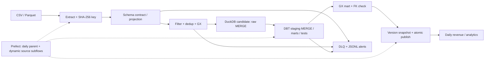
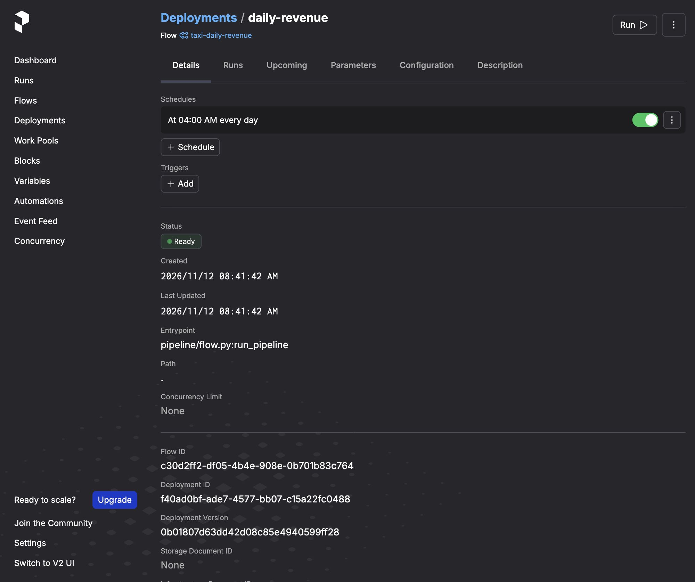
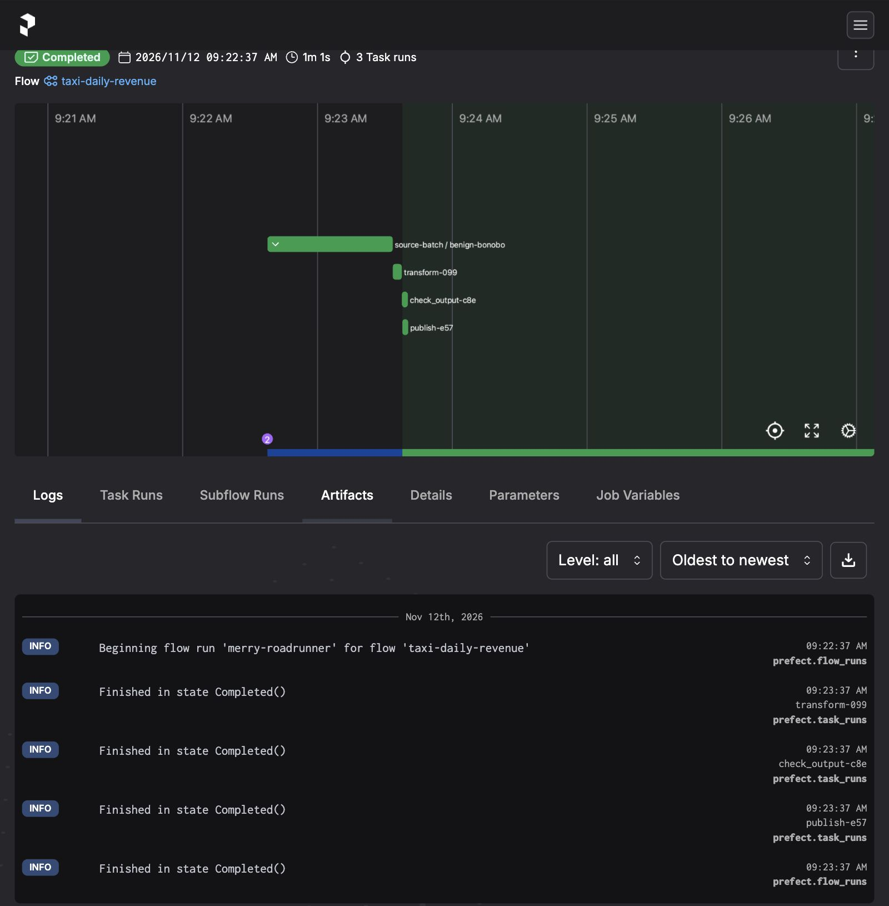
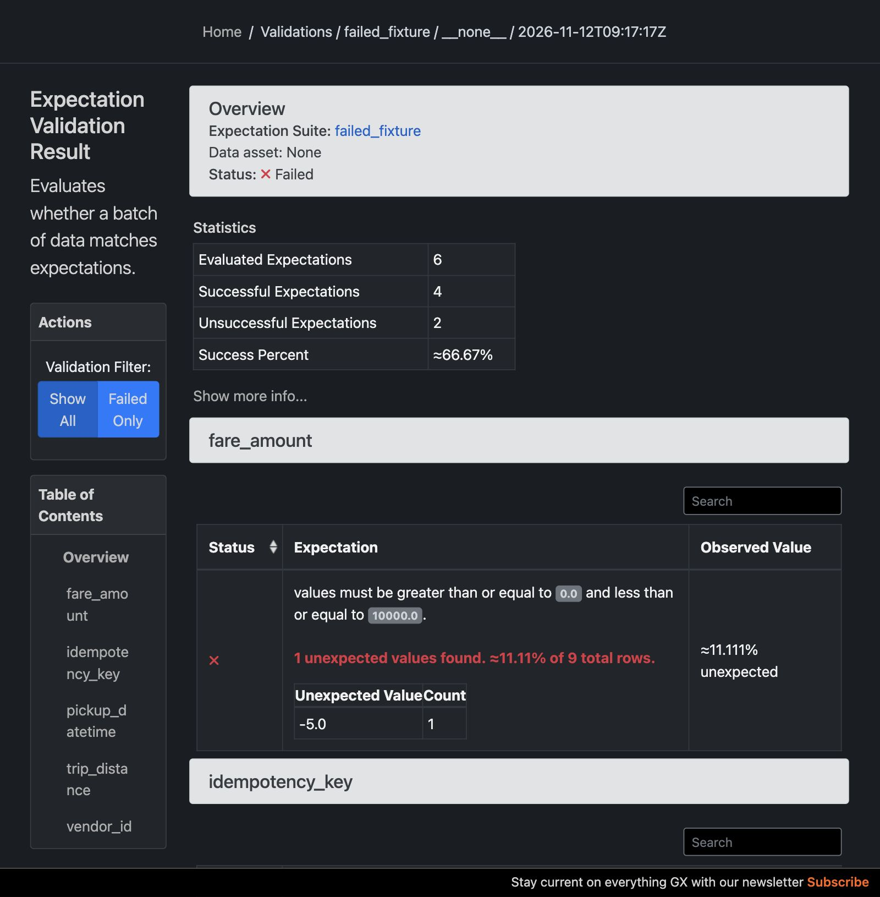
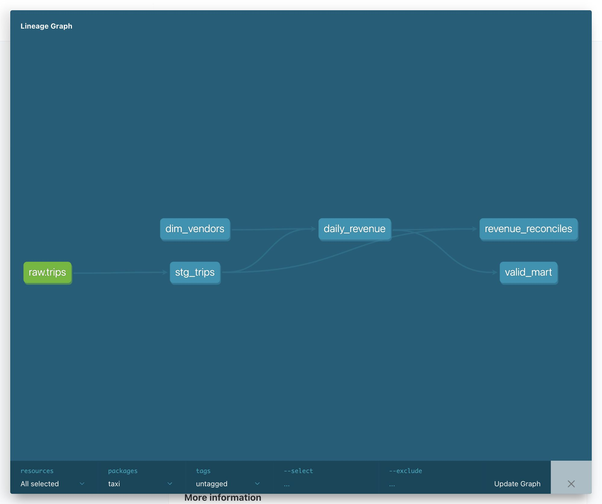

# Taxi ELT

Ежедневная аналитика выручки NYC Yellow Taxi: дата × геоячейка около 1 км × поставщик.
Сценарий 1 - аналитика продаж, адаптированная к оплате поездок: обработка до 06:00,
доступность отчётности к 07:00 по `America/New_York`. Запуск по расписанию в 04:00.
Датасет - NYC Yellow Taxi 2015–2016. Последнюю цифру зачётки нужно указать самостоятельно:
она не сообщена и не подменяется номером бизнес-сценария.

## Запуск

```bash
docker compose up --build
```

Первый запуск автоматически выполняет пайплайн дважды, проверяет идемпотентность и DLQ,
печатает обязательный блок `## METRICS ##`, затем обслуживает ежедневный deployment.
Prefect UI: <http://localhost:4200>. Отчёты: <http://localhost:8081/runs/> - выбрать запуск
и открыть `report.html` (времена этапов, ссылки на GX HTML и статический DBT Docs с lineage).
Сервисы привязаны только к localhost; это локальный стенд, без публичной аутентификации.

```bash
docker compose exec pipeline python -m pipeline run
docker compose exec pipeline python -m pipeline run --fault load
docker compose exec pipeline python -m pipeline versions
docker compose exec pipeline python -m pipeline read --version <имя-снимка.duckdb>
docker compose exec pipeline python -m pipeline restore --version <имя-снимка.duckdb>
docker compose down
```

Без Docker: Python 3.13, `uv sync --locked`, затем `uv run python -m pipeline demo`.
Для UI отдельно `uv run prefect server start`, после этого задать
`PREFECT_API_URL=http://127.0.0.1:4200/api` и запустить `uv run python prefect/dags/etl_pipeline.py`.
Проверки: `uv run pytest -q`, `uv run ruff check .`.

В образ включён **синтетический fixture** в схеме исходных данных: 9 строк, включая дубль,
отрицательную стоимость и пропуск расстояния. Это тестовые данные, не результаты на полном NYC.
Для настоящих CSV/Parquet задать `TAXI_SOURCE` на каталог входных файлов; нужны поля
`vendor_id`, `pickup_datetime`, `dropoff_datetime`, `pickup_longitude`, `pickup_latitude`,
`fare_amount`, `trip_distance`. Поддержаны также TLC-имена `VendorID`,
`tpep_pickup_datetime`, `tpep_dropoff_datetime`. Остальные поля проецируются с предупреждением.
Для Compose дополнительно примонтировать этот каталог в контейнер и задать `TAXI_SOURCE`.
Источник: [NYC Yellow Taxi 2015–2016](https://www.kaggle.com/datasets/elemento/nyc-yellow-taxi-trip-data).

## Часть 1: Проектирование пайплайна



Выбран **ELT с предварительным контролем входа**: Python проверяет контракт и отделяет
ошибки, основная очистка представления и бизнес-агрегации выполняются DBT SQL внутри DuckDB.
Нет Spark/JVM и облачных аккаунтов; для локального объёма SQL-движка достаточно.

| Требование | Решение и обоснование |
|---|---|
| Идемпотентность | Стабильный SHA-256 естественного ключа, dedup keep-last, настоящий SQL MERGE в raw и staging |
| Исправления и late data | Стоимость не входит в ключ; полный пересчёт marts видит исправления старых дат |
| Time Travel | Неизменяемые полные снимки согласованной DuckDB; чтение версии и атомарный restore |
| Операционные сбои | Prefect: до 3 повторов после первой попытки, задержки 1/2/4 секунды; только OSError/timeout |
| Битые записи | JSON DLQ с причиной и исходными значениями, адресация по содержимому; пороговый alert |
| Schema drift | Добавочные поля → прежняя проекция с alert; потеря обязательных → DLQ, отказ без retry, сохранение старой публикации |
| Качество | GX до raw-load и после SQL; not-null, диапазоны, уникальность и число orphan FK; DBT relationships + сверка выручки |
| Оркестрация | Task-зависимости через результаты; динамический subflow для каждого файла, общий повторяемый шаблон |
| Публикация | Межпроцессный writer-lock, candidate DB и atomic rename только после всех gates |
| Мониторинг | JSONL события и alerts, метрики запуска, HTML/SVG длительности, GX Data Docs, DBT Docs, Prefect UI |
| SLA | Расписание 04:00, alert при завершении после 06:00 или превышении `MAX_DURATION_SEC` (по умолчанию 3600) |

Ключ составлен из поставщика, времени начала/окончания и координат посадки: в исходнике нет
trip_id. Разные реальные поездки с одинаковым набором этих полей неразличимы; для production
нужен стабильный идентификатор источника. Коррекция полей самого ключа считается новой поездкой.
DLQ-метрика считает строки уникальных пакетов ошибок по содержимому, а не повторы доставки.
`DATA_QUALITY_SCORE` - доля успешных проверок **выходной витрины**, не доля чистых исходных строк.

Снимки реализованы на уровне приложения, **не нативный Delta/Iceberg Time Travel**.
Они занимают полную копию БД на версию; для многопользовательского lakehouse нужен
транзакционный каталог/формат и политика retention. DuckDB здесь имеет одного writer;
чтение готовой публикации не заменяет распределённый аналитический сервис.
Между задачами передаются пути, не большие DataFrame в базе оркестратора.
Входной файл читается Pandas целиком: крупные месяцы нужно предварительно разделить на файлы,
либо заменить reader потоковым. Полный набор 47 млн поездок этим запуском не заявляется.

### Затраты ETL и ELT

Оба подхода используют локальную VM, поэтому лицензии равны 0. Условная модель:
VM 30 ₽/час, инженер 1500 ₽/час, 30 запусков/месяц, амортизация разработки 12 месяцев.
Это допущения, а не тариф провайдера или измерение человеко-часов.

| Подход | Разработка | Поддержка/месяц | TCO/месяц без вычислений |
|---|---:|---:|---:|
| ETL Python + отдельная загрузка | 8 ч | 2 ч | 4000 ₽ |
| ELT DuckDB + DBT | 6 ч | 1 ч | 2250 ₽ |

Вычисления добавляются как `30 × duration_sec / 3600 × 30 ₽`.
Для ETL длительность не измерялась: преимущества по скорости не утверждаются.
ELT упрощает SQL lineage и тестирование, ETL полезнее при сложных Python/ML-преобразованиях.
Для снимков дополнительно требуется `размер БД × число сохраняемых версий` диска.

Мультимодальный сценарий не выбран: эмбеддинги и версии энкодера не применяются.

## Часть 2: Реализация идемпотентности

Код: `pipeline/extract.py` (ключ и dedup), `pipeline/storage.py` (MERGE и версии),
`pipeline/flow.py` (проверка двух запусков), `tests/test_pipeline.py` (автоматические проверки).

```python
canonical = normalized.astype(str).agg("|".join, axis=1)
frame["idempotency_key"] = canonical.map(lambda value: hashlib.sha256(value.encode()).hexdigest())
```

```sql
MERGE INTO raw.trips AS target USING incoming AS source
ON target.idempotency_key = source.idempotency_key
WHEN MATCHED THEN UPDATE BY NAME
WHEN NOT MATCHED THEN INSERT BY NAME;
```

При повторе fixture число строк и уникальных ключей остаётся **6 / 6**,
на NYC - **97 713 / 97 713**; совпадает также отпечаток ключей и значений.
Исправление стоимости обновляет строку, а не создаёт дубль. DBT staging использует
`incremental_strategy: merge` с тем же ключом, marts пересчитываются из актуального staging.

Пример Time Travel: после первого запуска fixture снимок содержит выручку **111,50 USD**;
после исправления - **199,00 USD**. Чтение первой версии по-прежнему возвращает 111,50,
а `restore` восстанавливает первоначальный отпечаток. Команды чтения и отката приведены выше.
Вывод: SQL MERGE и согласованный снимок упрощают идемпотентность; обычного append недостаточно.

## Часть 3: Обработка ошибок

Код: `pipeline/flow.py` (retry и последовательность этапов),
`pipeline/extract.py` (DLQ и schema drift), `pipeline/observability.py` (логирование и инъекции).

```python
task(retries=3, retry_delay_seconds=exponential_backoff(backoff_factor=1),
     retry_condition_fn=retry_operational, cache_policy=None)
```

Операционные OSError/timeout повторяются максимум четыре раза суммарно; ошибки данных
не повторяются. Каждый этап пишет start/finished/failed и длительность в JSONL.
Проверены искусственные сбои `extract`, `validate`, `load`, `transform`, `quality`,
`publish`: после одного сбоя каждый этап восстанавливается. Постоянная ошибка extraction
заканчивается после четырёх попыток. Ошибка SQL не меняет последнюю опубликованную БД.

Пример записи DLQ из fixture (показаны существенные поля):

```json
{"reason":"invalid_values","rows":[{"vendor_id":1,"fare_amount":-5.0}]}
```

Полная запись содержит все семь исходных полей и ключ; имя файла - hash содержимого.
Fixture даёт две ошибочные строки, повторная доставка не увеличивает счётчик.
Порог `DLQ_THRESHOLD` порождает JSONL alert. При добавлении колонок используется предыдущая
проекция с предупреждением; потеря обязательных полей даёт DLQ и отказ от публикации.
Вывод: retry исправляет временные сбои, но не маскирует нарушение контракта данных.

## Часть 4: Оркестрация пайплайна

Deployment: `prefect/dags/etl_pipeline.py`, flows/tasks: `pipeline/flow.py`:
`extract → check_input → load → transform → check_output → publish`.
Внутри родительского flow список файлов определяется динамически; для каждого вызывается
повторно используемый `source-batch` subflow. Внутри него динамически создаются
`region-batch` subflows для фактически встреченных геоячеек с теми же границами, что в SQL-витрине.
Зависимости задаются передаваемыми результатами задач; публикация невозможна до quality gate.
Ежедневное расписание - 04:00 `America/New_York`, одновременно обслуживается один запуск.





Ручной запуск и восстановление задач проверены. Производительность на NYC:
70,00 с первый запуск, 60,05 с повтор; подробные результаты - в итоговой таблице.
Отдельный subflow на геоячейку добавляет накладные расходы оркестрации и последовательных MERGE.
SLA alert создаётся после 06:00 или при превышении часового бюджета.
Вывод: Prefect даёт видимые состояния, retries и subflows без отдельного описания DAG.

## Часть 5: Тестирование данных с Great Expectations

Конфигурация: `great_expectations/expectations/trips.json` (входные проверки),
`great_expectations/expectations/mart.json` (проверки витрины),
`great_expectations/checkpoints/quality.json` (checkpoint), `pipeline/quality.py` (интеграция).
Используется актуальный API GX: Data Context → ValidationDefinition → Checkpoint.

| Проверки | До загрузки | После трансформации |
|---|---|---|
| Not null | ключ, дата посадки | дата отчёта |
| Диапазоны | стоимость, расстояние | выручка ≥ 0, поездок ≥ 1 |
| Уникальность | idempotency_key | дата × регион × поставщик |
| Связи | поставщик входит в справочник | число orphan FK равно 0 |

GX запускается отдельными задачами до raw-load и после DBT. На неочищенном fixture
проваливаются две проверки из шести: уникальность ключа и диапазон стоимости.
Отсутствующее расстояние дополнительно отсекает входной фильтр. При ошибке GX
создаются HTML Data Docs, DLQ и alert, выбрасывается ValueError. Это проверяет
`test_gx_failed_report`; публикация не выполняется. На очищенной витрине все пять проверок
успешны: `DATA_QUALITY_SCORE=1.00`.

HTML: в [каталоге запусков](http://localhost:8081/runs/) открыть `report.html` → GX Data Docs.
Пример HTML проваленной проверки: `runtime/gx-failed/quality/gx/uncommitted/data_docs/local_site/index.html`.

Для реального прогона: `runtime/real-regions/runs/<run>/quality/gx/uncommitted/data_docs/local_site/index.html`.
Вывод: входной и выходной gates предотвращают публикацию некорректной витрины.

## Часть 6: DBT для трансформаций (ELT)

```text
dbt/
  models/staging/     stg_trips.sql, sources.yml
  models/marts/       daily_revenue.sql
  models/schema.yml  unique, not_null, relationships
  seeds/             dim_vendors.csv
  macros/            region.sql
  tests/             revenue_reconciles.sql, valid_mart.sql
```

Staging `dbt/models/staging/stg_trips.sql` нормализует дату и типы, вычисляет регион,
фильтрует недопустимые значения. Mart `dbt/models/marts/daily_revenue.sql` агрегирует
по дате, геоячейке и поставщику, соединяя справочник через `ref`.

```sql
select service_date, region, vendor_id, vendor_name,
       count(*) as trips, sum(fare_usd) as revenue_usd
from {{ ref('stg_trips') }}
join {{ ref('dim_vendors') }} using (vendor_id)
group by all
```

Повторяющееся вычисление геоячейки вынесено в макрос. Prefect запускает `dbt build`,
затем `dbt docs generate --static`. Успешны **12 DBT-тестов**, включая связи,
уникальность, допустимость витрины и сверку итоговой выручки с источником.
На NYC получены 1 223 строки и 1 303 455,73 USD.



Вывод: DBT хранит бизнес-логику в SQL и делает связи и проверки частью одного build.

## Часть 7: Интеграция в CI/CD

## Структура

```text
pipeline/                 extract, quality, storage, flow, DBT runner, monitoring
prefect/dags/etl_pipeline.py  автозапуск и ежедневный Prefect deployment
dbt/                      staging, marts, macros, seed-справочник, тесты
great_expectations/       декларативные suites и параметры checkpoint
tests/                    идемпотентность, DLQ, drift, rollback, сбои каждого этапа
data/sample/              небольшие тестовые данные внутри образа
docs/                     скриншоты Prefect UI и DBT lineage
runtime/                  БД, версии, логи, DLQ, HTML (не в Git)
Dockerfile
docker-compose.yml
pyproject.toml / uv.lock / requirements.txt
.github/workflows/ci.yml   тесты, staging, production
```

## Результаты

Проверено на macOS/Apple Silicon, Python 3.13; Docker - Linux ARM64.
`pytest`: **14 passed**, Ruff - без замечаний. Проверены исправление уже загруженной
поездки, повторная загрузка, schema drift, чтение старой версии и rollback, восстановление
после сбоя каждого из шести этапов, исчерпание четырёх попыток, GX HTML при ошибке
и ежедневное расписание deployment.

| Прогон | Вход | Сохранено / уникальных ключей | DLQ | GX витрины | Длительность |
|---|---:|---:|---:|---:|---:|
| Docker, синтетический fixture, повтор | 9 | 6 / 6 | 2 | 100% | 4,55 с |
| NYC 2016-01, первые 100 000 строк | 100 000 | 97 713 / 97 713 | 2 287 | 100% | 70,00 с |
| Тот же NYC-файл повторно | 100 000 | 97 713 / 97 713 | 2 287 | 100% | 60,05 с |

В обоих сценариях отпечаток raw после повторного запуска совпал; DLQ не удвоилась.
На NYC построено 1 223 строки витрины с выручкой **1 303 455,73 USD**;
успешны все 12 DBT-тестов. Это небольшая последовательная выборка, не полный месяц
и не прогноз SLA для всех 47 млн строк. Время включает задачи и SQL/GX, но не старт сервера;
два запуска не являются статистическим бенчмарком. При принятой цене VM вычисления
для 30 таких повторных запусков составили бы около 15,01 ₽/месяц без постоянно работающего UI.